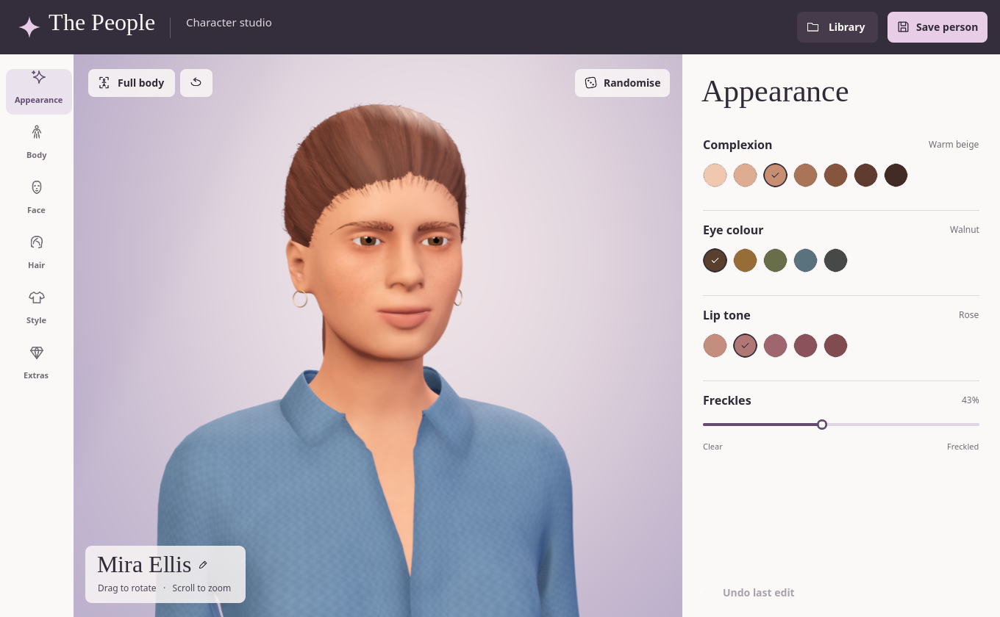

# The People

A standalone, real-time character studio for Godot 4.7. The character uses a sculpted human mesh, fitted garments, and GPU blend shapes. All surface textures are generated procedurally.



## Run

Open `project.godot` in Godot 4.7 and press **F6** on the studio scene or **F5** from the project. From a terminal in this directory:

```sh
godot --headless --import
godot
```

The project ships its baked meshes and uses the Forward+ renderer. Playing requires a graphics device supported by Godot Forward+. The asset-generation tools are optional.

## Create a person

- Use **Appearance** for complexion, iris colour, lip tone, and freckles. **Face** adjusts the jaw, cheekbones, eyelid opening, nose width, and mouth width.
- **Body** controls stature, weight, musculature, frame, hip width, and relative leg length. The same sculpted changes drive the garment fitting coordinates.
- Choose a cut, length, and colour in **Hair**. **Style** mixes tops and bottoms with dye and fabric patterns. **Extras** adds gold hoops or a felt fedora.
- Drag the preview to orbit, scroll to zoom, and use the portrait/full-body or reset-camera buttons. Selecting a category frames the relevant area.
- Click the name to rename the person. **Randomise** generates a new appearance. **Undo last edit** restores the previous appearance.
- **Save person** creates a library entry, then updates that entry on subsequent saves. Open **Library** to load a person or start another. The application writes versioned JSON under Godot's `user://people/` directory and replaces each save atomically.

## Rendering and geometry

The base is MakeHuman HM08. The offline pipeline applies body and face sculpts, transfers displacement to accessories through their barycentric fitting weights, refines the body and garment topology, and calculates normals for every shape. Outfit-specific body masks and separate upper/lower garment regions support mixed wardrobes.

The swept ponytail follows the individual scalp and adds tapered strand geometry, loose hairs, and a separate tail-length morph. The bob and crop use fitted hair meshes. The lids and lashes share an idle blink. The skin shader combines facial pigment masks, object-space ambient visibility, subsurface scattering, procedural freckles, and fine roughness and normal variation. Procedural shaders also generate iris fibres, hair and fabric detail. The brow and lash opacity maps are seeded drawings of individual fibres.

## Rebuild the art

1. Obtain the MakeHuman data directory and extract the named system-pack geometry listed in [asset provenance](licenses/ASSETS.md).
2. Use Python with NumPy and Pillow, a C++17 compiler, and Godot 4.7. Supply a fresh staging directory and run the commands below from the project root. The pipeline reads OBJ topology, fitting data, and target displacement files.

```sh
python tools/fiber_maps.py
OPENBLAS_NUM_THREADS=1 python tools/build_meshes.py /path/to/makehuman/data /path/to/extracted-system-pack /tmp/the-people-meshes
godot --headless -s tools/bake.gd -- /tmp/the-people-meshes
godot --headless --import
```

## Verify

```sh
XDG_DATA_HOME=/tmp/the-people-qa godot --headless -s tools/verify.gd
```

For rendered verification, create an output directory and run `godot -s tools/verify.gd -- /absolute/path/to/output` with a working GPU/display. The check drives the studio controls, verifies morphs, exercises orbit and zoom, and saves and reloads a test person. It removes its temporary library entry after verification.
